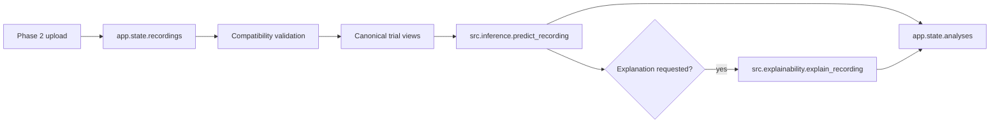

# Phase 3: Model Adapter and Inference API

## Architecture



`compatibility.py` checks the Phase 2 canonical representation. `preprocessing.py` selects continuous arrays or independent trial views and performs no filtering. `inference.py` and `explainability.py` delegate to Phase 1. `service.py` coordinates async storage and thread-pool work. `routes.py` exposes the API. Analysis data is process-local and guarded by an async lock.

## Model contract

The final artifact type is `final_cell1_transformer_handcrafted_fusion`. Inputs are 256 Hz, two channel slots, 1,024 sample epochs, 4 seconds, with one second trimmed from each edge; filtering is fourth-order zero-phase Butterworth 0.5–40 Hz, no notch, and 40 handcrafted features. Mapping is Control=0, ADHD=1, threshold 0.5. The Phase 1 functions own all signal processing and model logic.

## API

- `GET /api/v2/analyses/model-status` returns availability, contract, threshold, mapping, and limitations.
- `GET /api/v2/analyses/{recording_id}/compatibility` reports technical compatibility.
- `POST /api/v2/analyses/{recording_id}` accepts `{"include_explanation": false}` and returns analysis, per-trial results, processing metadata, and limitations.
- `GET /api/v2/analyses?recording_id=...` lists stored results, optionally filtered by recording.
- `GET /api/v2/analyses/{analysis_id}` retrieves one analysis; optional `recording_id` enforces ownership matching.
- `GET /api/v2/analyses/{analysis_id}/explanation` retrieves explanation status and values.

Example request: `POST /api/v2/analyses/rec-123` with body
`{"include_explanation": true}`. A successful response has this shape (probabilities below are illustrative placeholders, not a model result):

```json
{
  "analysis_id": "<generated-id>",
  "recording_id": "rec-123",
  "status": "ok",
  "predicted_class": "ADHD",
  "adhd_probability": 0.62,
  "control_probability": 0.38,
  "threshold": 0.5,
  "model_metadata": {"artifact_type": "final_cell1_transformer_handcrafted_fusion", "training_epoch_count": 553},
  "processing_metadata": {"sampling_rate_hz": 256, "trial_count": 1, "provenance": "csv"},
  "created_at": "<UTC timestamp>",
  "scientific_limitations": ["..."],
  "explanation": {"status": "available", "method": "joint_integrated_gradients", "integration_steps": 128},
  "trials": [{"trial_index": 0, "status": "ok", "summary": {"...": "..."}}]
}
```

## Compatibility and flow

Import status must not be rejected, rate must be known and exactly 256 Hz, channel count must be two, canonical orientation must be known, all values finite and real, and each trial must have at least 1,536 samples for edge trimming plus an epoch. Source orientation provenance may be 0 or 1 because Phase 2 canonicalizes arrays; `unknown` is rejected. Epoched trials are passed independently and never concatenated. Two array slots do not establish physical electrode identity (scientific compatibility remains unverified).

Predictions execute in a thread pool and use the already initialized `app.state.predictor`. Integrated Gradients use Phase 1's 128-step implementation. Explanation failures preserve predictions and report unavailable status. Errors are returned with a safe detail and error type; internal exception details are logged only by type.

## Limitations

The model used 553 Cell 1 epochs. Participant-independent generalization and independent test evaluation are not established. This is not a clinical diagnostic tool; probabilities are not calibrated diagnostic confidence. Physical electrode identities for channel slots are unverified. Integrated Gradients are exploratory attribution, not causal or diagnostic evidence. In-memory results are process-local and nonpersistent.

## Testing

Run the Phase 3 tests with `python -m pytest api/tests/model_adapter -q`, the full API suite with `python -m pytest api/tests -q`, and Phase 1 regressions with `python -m pytest tests -q`. A real-checkpoint API integration run requires the configured checkpoint and supported model dependencies.
